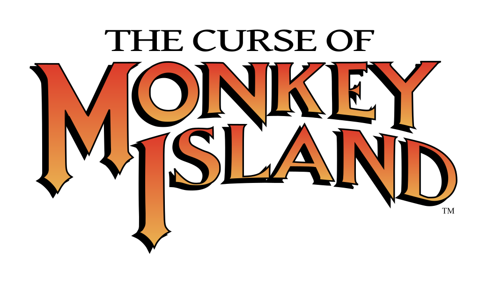

<p align="center"></p>

# Remasterización de audio para The Curse of Monkey Island

*English: see [README.md](README.md).*

Un instalador hecho por fans que le da audio en alta calidad a **The Curse of Monkey Island** (LucasArts, 1997) cuando se
juega con **ScummVM**. Reemplaza la música comprimida del juego por la **banda de sonido oficial en calidad sin pérdida**
(lossless) y remasteriza digitalmente las voces y el audio de los videos.

**No incluye audio.** Genera el audio nuevo en su equipo a partir de **su propia copia del juego** y de la banda de sonido
en FLAC publicada por Mixnmojo, que el instalador descarga.

**[Descargar la última versión](../../releases/latest)** (un solo archivo: `Audio-Remaster-for-The-Curse-of-Monkey-Island.exe`, Windows de 64 bits).

## Qué hace

- **Música:** donde la banda de sonido oficial tiene la misma grabación que el juego, la música comprimida del juego se
  reemplaza por la **banda de sonido sin pérdida** (origen FLAC, 44,1 kHz, guardada sin comprimir en los archivos del
  juego). No altera la música del juego: ninguna pista se cambia por otra versión porque suene mejor.
  La música que no está en el disco se **remasteriza digitalmente** a partir del audio del juego: reducción del ruido del
  códec y regeneración de los agudos, calibradas con los temas que sí están en el disco, para que suene pareja con el resto.
- **Voces:** las 8.490 frases se **remasterizan digitalmente**: reducción del ruido del códec,
  suavizado de las eses y regeneración de los agudos, a 44,1 kHz.
- **Videos:** se usa la banda de sonido sin pérdida donde la música coincide; las voces y los efectos se remasterizan
  digitalmente con el mismo método. Los videos no se modifican: ScummVM reproduce un archivo `.ogg` aparte, junto a cada
  video.
- **Reversible:** los archivos originales se guardan en una subcarpeta y se restauran desde el mismo programa.

## Requisitos

- El juego original, **versión CD de Windows**. Lo más probable es que funcione con cualquier idioma, pero solo se probó
  con las versiones en **castellano e inglés**.
- **ScummVM**, o RetroArch con el núcleo ScummVM. El parche está pensado solo para ScummVM, no para el ejecutable original
  del juego de 1997.
- La **banda de sonido en FLAC publicada por Mixnmojo** (1,2 GB). El instalador la descarga desde Mixnmojo o desde
  Internet Archive; también puede indicarse un `.zip` que ya se tenga. Se verifica que sea exactamente esa edición.
- Unos **10 GB libres** en el disco del juego durante el proceso. Al finalizar, el juego ocupa unos 3,5 GB más.

## Modo de uso

1. Cierre ScummVM / RetroArch.
2. Abra `Audio-Remaster-for-The-Curse-of-Monkey-Island.exe`.
3. Indique la carpeta del juego, elija desde dónde descargar la banda de sonido y siga los pasos.
4. El proceso demora entre 10 y 40 minutos según el equipo. **El juego no se modifica hasta que todo el audio nuevo está
   generado y validado**; si algo falla o se cancela, queda como estaba.

La interfaz está en castellano y en inglés (se cambia desde la esquina inferior izquierda).

### Dos puntos importantes

- **Ajuste de ScummVM:** el audio nuevo requiere la línea `dimuse_sample_rate=44100` en la entrada del juego dentro de
  `scummvm.ini`. El instalador la agrega si encuentra el archivo; si no, lo informa. Con RetroBat, el archivo es
  `bios\scummvm.ini` y puede indicarse desde el instalador.
- **Partidas guardadas antes de instalar:** pueden reproducir la música a mitad de velocidad al cargarlas (ScummVM guarda
  en la partida la posición y la frecuencia de lo que sonaba). Se soluciona pasando por una sala con otra música y
  guardando nuevamente, o comenzando una partida nueva.

### Desinstalación

Abra el mismo programa, indique la carpeta del juego y elija **Desinstalar el parche**. Se restauran los originales
guardados en la subcarpeta `_comi_remaster` y se verifica cada uno. No elimine esa subcarpeta si desea poder volver atrás.
También se quita el ajuste de ScummVM que haya agregado el instalador.

### Modo sin ventana (opcional)

```
"Audio-Remaster-for-The-Curse-of-Monkey-Island.exe" --auto "<carpeta del juego>" --zip "<banda.zip>"
"Audio-Remaster-for-The-Curse-of-Monkey-Island.exe" --auto "<carpeta del juego>" --desinstalar
```

El resultado se escribe en `COMI Audio Remaster - informe automatico.txt`, junto al programa (con `--en`, en inglés).

## Cómo se controla el resultado

- **Banda de sonido:** huella del archivo completo y de cada uno de los 79 temas.
- **Resultado:** cada pista de música, cada frase de voz y cada video se comparan con una firma de referencia del
  resultado esperado. La comparación se hace sobre la forma de onda con una tolerancia mínima, porque el mismo cálculo da
  diferencias inaudibles en procesadores distintos.
- **Estructura:** tamaños, regiones, saltos y marcas de cada archivo, para que el juego los lea igual que a los originales.

## Avisos de Windows y de antivirus

- El programa **no tiene firma digital**. Al descargarlo de internet, Windows SmartScreen puede
  mostrar un aviso azul. Haga clic en **Más información** y después en **Ejecutar de todas formas**.
- Algunos antivirus pueden marcarlo. Es un programa en Python de un solo archivo armado con PyInstaller, un método de
  empaquetado que también usa el malware, y es nuevo, sin reputación todavía. El código completo está en este
  repositorio, y el `.exe` se puede armar uno mismo (ver abajo).

## Armarlo desde el código

Con Python 3.10 (64 bits) en Windows:

```
python -m venv venv
venv\Scripts\pip install -r requirements.txt
venv\Scripts\python armar_exe.py
```

El programa queda en `dist\`. Para correrlo sin armarlo: `venv\Scripts\python app_reconstruye.py`.

Organización: `comi\` (interfaz, detección del juego, instalación y desinstalación), `comi\motor\` (el procesamiento del
audio), `datos\` (huellas de los archivos conocidos del juego, la receta de qué tema del disco corresponde a cada pista y
las firmas de referencia del resultado esperado). En `herramientas\` están el programa que generó `datos\` (necesita los
archivos de trabajo del autor, que incluyen audio del juego y no se publican) y una prueba de punta a punta.

## Créditos

- **The Curse of Monkey Island** © LucasArts / Lucasfilm. Este proyecto no está asociado ni avalado por Lucasfilm,
  LucasArts ni Disney. Hace falta una copia propia del juego.
- **Banda de sonido:** la edición en FLAC publicada por [Mixnmojo](https://mixnmojo.com/), también disponible en
  [Internet Archive](https://archive.org/details/the-curse-of-monkey-island-soundtrack). No se incluye: el instalador la
  descarga desde donde está publicada.
- **[ScummVM](https://www.scummvm.org/):** los lectores de los archivos de audio `.BUN` y del audio de los videos son
  traducciones a Python de código de ScummVM (GPL v3 o posterior), y el conocimiento de los formatos sale de su código.
  ScummVM es propiedad de sus desarrolladores.
- **Logo** de The Curse of Monkey Island: de [Wikimedia Commons](https://commons.wikimedia.org/wiki/File:Thecurseofmonkeyisland-logo.svg) (dominio público; marca registrada de Lucasfilm).
- Desarrollado por **SamuelEchoes**.

## Licencia

Copyright (C) 2026 SamuelEchoes

Este programa es software libre: puede redistribuirlo y/o modificarlo según los términos de la **Licencia Pública General
de GNU, versión 3 o (a su elección) cualquier versión posterior**. Se distribuye SIN NINGUNA GARANTÍA. Ver
[LICENSE](LICENSE) (texto oficial, en inglés).

La licencia cubre solo este programa. No da ningún derecho sobre el juego, su audio ni la banda de sonido.
